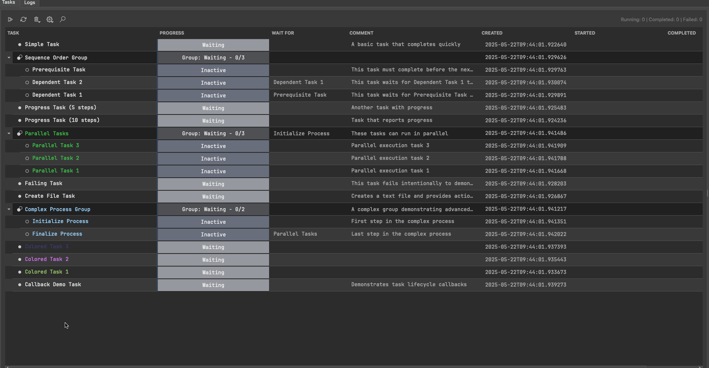

# tqm: Task Queue Manager

A simple PySide2 no-dependency framework for managing and executing tasks in parallel with a nice UI. Helps you create, queue, and track multiple tasks with dependencies and progress reporting.



## What is this?

TQM lets you run multiple tasks in the background while showing their progress in a UI. It's built with only PySide2 and handles all the complex stuff like threading, dependencies between tasks and UI.

Basically, a Task Queue Manager.

## Features

- **Task Management**
  - Run multiple tasks in parallel (multi-threaded)
  - Create task groups with parent-child relationships
  - Set dependencies so tasks wait for others to finish
  - Various retry strategies including delays, conditional logic, and custom policies

- **UI Features**
  - Progress bars (both determinate and indeterminate)
  - Task filtering and search
  - Context menus for task actions
  - Detailed debug view showing task properties

- **Developer Features**
  - Simple API for creating and queuing tasks
  - Callbacks for task lifecycle events (start, finish, fail, complete)
  - Predicates to control when tasks should run
  - Stop tasks that opt in: check `task.cancel_requested` in long loops, or run commands with `tqm.utils.run_process`
  - Customizable task colors and more
  - Comprehensive typing annotations

## Installation

```bash
poetry add tqm
# or pip
pip install tqm
```

Dependencies:
- PySide2

## Quick Start

```python
import time
from PySide2.QtWidgets import QApplication
from tqm import TQManager

def some_task(task):
    # This will run in a separate thread
    time.sleep(2)
    task.log("Task completed!")

# Create the application
app = QApplication([])
app.setStyle('Fusion')

# Create the task manager window
task_manager = TQManager(app_name="my_app")
task_manager.show()
task_manager.log("Manager ready")  # shows in this window's log panel

# Add a simple task
task_manager.add_event(
    execute=some_task,
    label="My First Task",
    comment="This is a sample task"
)

# Start executing tasks
task_manager.start_workers()

# Run the application
app.exec_()
```

## Examples

### Creating a simple task

```python
# Add a single task that does something
task_manager.add_event(
    execute=lambda task: print("Hello, world!"),
    label="Simple Task",
    comment="Prints a greeting"
)
```

### Creating a task group

```python
# Create a group of related tasks
with task_manager.create_group("Download Files") as group:
    group.add_event(lambda t: t.log("Downloading file 1"), label="File 1")
    group.add_event(lambda t: t.log("Downloading file 2"), label="File 2")
    group.add_event(lambda t: t.log("Downloading file 3"), label="File 3")
```

### Using the TaskBuilder for more control

```python
from tqm import TaskBuilder

# Create a task with the builder pattern
task = (
    TaskBuilder("Complex Task")
    .with_event(lambda t: t.log("Task running..."))
    .with_comment("A task with callbacks")
    .with_on_start(lambda t: print("Starting task"))
    .with_on_completed(lambda t: print("Task completed"))
    .with_on_failed(lambda t: print("Task failed"))
    .with_color("lightblue")
    .with_retry(max_attempts=3)  # Retry up to 3 times if it fails
    .build()
)

# Add it to the task manager
task_manager.add_tasks(task)
```

### Tasks with dependencies

```python
# Create tasks with dependencies
task1 = TaskBuilder("Task 1").with_event(lambda t: t.log("Task 1 done")).build()
task2 = (
    TaskBuilder("Task 2")
    .with_event(lambda t: t.log("Task 2 done"))
    .with_wait_for(task1)  # This will wait for task1 to complete
    .build()
)

task_manager.add_tasks(task1, task2)
```

### Retry policies

```python
from tqm import TaskBuilder, retry_policy

# retry_if gets the exception and returns True to retry.
policy = retry_policy.conditional_retry(
    3, retry_policy.FixedDelay(5), retry_if=lambda exception: isinstance(exception, IOError)
)
task = TaskBuilder("Download").with_event(download).with_retry_policy(policy).build()
```

A group does not retry: `TaskGroupBuilder.build()` raises `TaskGroupError` if the builder has a
retry policy. Give the retry policy to the tasks in the group.

### Stopping a task

Python threads cannot be killed, so only a task whose callable stops when asked can be stopped.
Say so when you set the callable, with `cancellable=True`:

```python
task = TaskBuilder("Render").with_event(render, cancellable=True).build()
```

Then right-click it and pick Stop selected, or call `task_manager.cancel_tasks(task)`. A task
without `cancellable=True` cannot be stopped in any state: Stop selected is not offered for it,
and `cancel_tasks` leaves it alone and logs a warning. A group has no flag: it can be stopped only
if all its tasks are cancellable.

The tasks that wait for a stopped task end cancelled too, cancellable or not, since they can never
run. A running task that is not cancellable is never asked to stop: it finishes on its own.

The callable cooperates like this:

```python
from tqm.utils import run_process

def render(task):
    # Output goes to the task log. A stop or the timeout kills the whole process tree.
    run_process(task, ["nuke", "-x", "comp.nk"], timeout=3600)

def convert(task):
    for frame in frames:
        if task.cancel_requested:
            return
        convert_frame(frame)
```

For other blocking work, register a hook: `task.on_cancel(connection.close)`.

### Executor events

```python
task_manager.callbacks.on_task_failed(lambda task, exception: print(task.name, exception))
```

`on_task_failed` fires once, when the task fails for good, with the task and its exception.

### Threads and lifetime

- Add and start tasks only from the thread that created the manager (the main thread). Calls
  from other threads raise `TaskError`.
- A removed task cannot be added again: `add_tasks` raises `TaskError`. Build a new task.
- `shutdown()` returns at once. Tasks that have not started are removed and end deleted. Running
  tasks finish in the background, without retries.
- A `TaskExecutor` used without a `TQManager` window must get a Qt parent, or be kept alive and
  deleted on the main thread. Left to Python's garbage collector, it can be freed on a worker
  thread and crash the process.

## Configuration

tqm stores its settings in:
- Windows: `%LOCALAPPDATA%\tqm\[app_name]\`
- Linux/Mac: `~/.config/tqm/[app_name]/`

## Environment

- `TQM_QSS_PATH` -Qt stylesheet path
- `TQM_MONO_FONT` - Monospace font family. It replaces the bundled font
- `TQM_DEBUG` - Enables debug logging when set to '1'
- `TQM_IDLE_TIMEOUT` - Timeout in milliseconds for idle system detection

tqm does not set `TQM_CONFIG_PATH` or `TQM_SETTINGS_PATH`. Several managers in one process
each keep their own config folder.

## Python Version Support

TQM currently supports Python 3.9 and 3.10, for VFX environments that still ship older Python versions. We intentionally keep zero dependencies (except PySide2) so VFX applications can use TQM right away.
However, we'll phase out support for older versions with major releases:

- Current (0.x): Python 3.9+
- Future (1.x): Python 3.10+ (dropping 3.9 support)

Older TQM versions will remain available on the GitHub releases page, but won't receive updates once we move to newer Python versions.

## Current Status

tqm is still under development but stable enough for most use cases. The core functionality has been battle-tested in production environments for over a year, though this current version is a significant rewrite with improved architecture and features. Some features and documentation might be improved in future updates.

See the [GitHub Project](link) for more information.

## Theme and style

This application was designed under the OS **dark theme** using Qt's **Fusion** style. I have never tried it under light themes or other Qt styles (Windows, macOS native, Breeze, etc.) which means that I assume no responsibility for any eye damage or aesthetic trauma.

### Custom Styling

The application provides a style.qss file in the default config location which users can modify to customize the appearance of common widgets:

- `TqmHeaderView`
- `TqmTasksLogs`
- `TqmTasksViewToolbar`
- `TqmSearchBar`
- `TqmStatusLabel`
- `TqmTasksTreeView`
- `TqmFrame`
- `TqmToolButton`

## License

This project is licensed under [MIT](./LICENSE.md).
